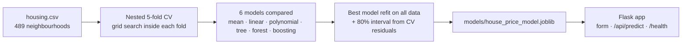
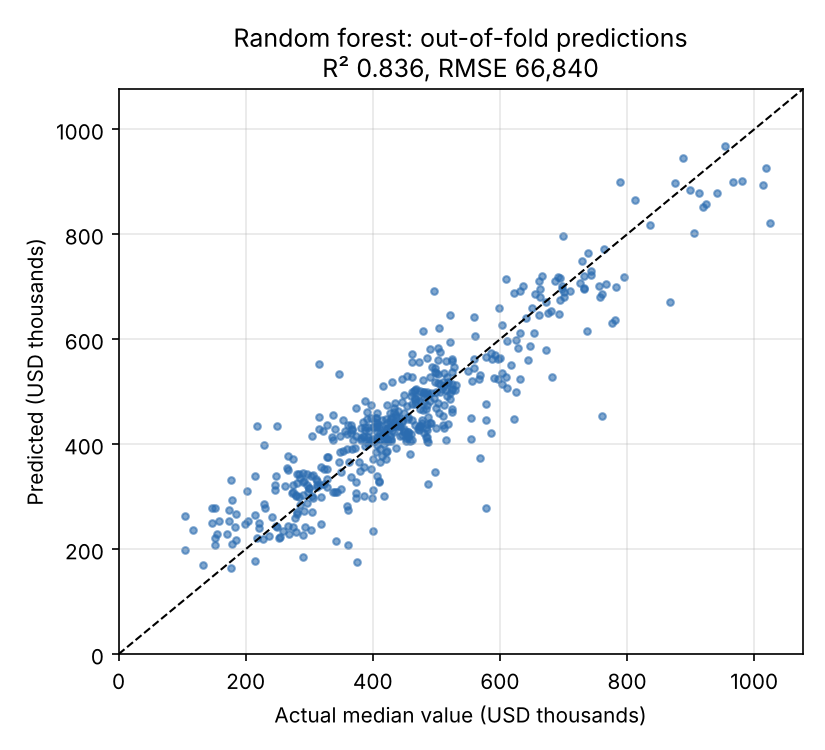

<div align="center">

# Boston Housing Prediction and House Price Predictor

**A house price model for 489 Boston neighbourhoods, chosen from six candidates with nested cross-validation, and the House Price Predictor Flask app that serves it with an honest price range.**

[](https://github.com/Collinsthe4th/boston-housing-prediction/actions/workflows/ci.yml)
[](https://www.python.org/)
[](https://flask.palletsprojects.com/)
[](https://scikit-learn.org/)

</div>

---

## Contents

- [About the project](#about-the-project)
- [Pipeline](#pipeline)
- [Tech stack](#tech-stack)
- [Results](#results)
- [The House Price Predictor app](#the-house-price-predictor-app)
- [Interactive dashboard](#interactive-dashboard)
- [Getting started](#getting-started)
- [Project structure](#project-structure)
- [Limitations](#limitations)

## About the project

This repository brings together two of my projects: the Boston housing model and the House Price Predictor web app that used to sit on its own. Keeping them in one place means the app always serves the model that the evaluation describes.

The data is the cleaned Boston housing sample from the Udacity machine learning course. It has 489 neighbourhoods and three features: `RM` (average rooms per home), `LSTAT` (percentage of residents with lower socio-economic status) and `PTRATIO` (pupils per teacher in local schools). The target is `MEDV`, the median home value in US dollars, adjusted for inflation. The average is 454,343 dollars.

## Pipeline



I used **nested cross-validation** (an outer loop that measures performance and an inner grid search that picks the settings). With a normal grid search, the same folds both tune and score the model, which makes the score look better than it really is. With only 489 rows, that bias can be large.

## Tech stack

| Area | Tools |
|---|---|
| Modelling | scikit-learn (linear, polynomial, decision tree, random forest, gradient boosting) |
| Evaluation | nested cross-validation, R², RMSE, MAE |
| Web app | Flask 3 (application factory, form and JSON API), plain CSS |
| Serving | gunicorn, `render.yaml` (trains the model during the build) |
| Testing | pytest with the Flask test client, GitHub Actions |

## Results

| Model | R² | RMSE (USD) | MAE (USD) |
|---|---|---|---|
| Mean (baseline) | -0.005 | 165,606 | 123,023 |
| Linear regression | 0.708 | 89,185 | 66,369 |
| Polynomial regression (degree 2) | 0.823 | 69,455 | 52,961 |
| Decision tree | 0.817 | 70,601 | 51,903 |
| **Random forest** | **0.836** | **66,840** | **49,274** |
| Gradient boosting | 0.834 | 67,296 | 50,887 |

Table 1- Out-of-fold scores from nested 5-fold cross-validation.



Fig. 1- Out-of-fold predictions of the random forest against the actual values. Source: Collins Akagha (2026).

The random forest had the best scores (R² of 0.836, so it explains about 84% of the variation in prices), with gradient boosting only 0.002 behind. The bigger finding is the jump from linear regression (0.708) to every non-linear model (0.817 to 0.836). This means the effect of each feature is not a straight line. For example, prices rise faster per extra room in neighbourhoods that already have large homes. A degree-2 polynomial captures most of that curve on its own (0.823).

Fig. 1 also shows where the model is weakest. Above about 750,000 dollars most points fall below the dashed line, so the model under-predicts the most expensive neighbourhoods. There are only a few such areas to learn from, and a random forest cannot predict beyond the highest values it has seen in training. Upon further research, I found that the original survey of 506 areas capped home values, and the capped areas (plus one outlier) were removed when this sample was cleaned, which leaves 489 areas and even fewer examples at the top.

## The House Price Predictor app

The app asks for the three features and returns the estimated median value with an 80% range. The range comes from the model's own errors during cross-validation (the 10th and 90th percentiles, -79,339 and +76,467 dollars). So the range shows how wrong the model has actually been on neighbourhoods it had not seen, and not a guess. Inputs outside the training range are rejected with a clear message, because the model should not be trusted far outside the data it has seen.

| Endpoint | Example | Returns |
|---|---|---|
| `GET /` and `POST /` | web form | page with the estimate and the range |
| `POST /api/predict` | `{"rm": 6.5, "lstat": 8, "ptratio": 17}` | `{"price_usd": 491887, "interval_80pct": [412548, 568355], ...}` |
| `GET /health` | | model name and cross-validated R² |

## Interactive dashboard

The Streamlit app (`streamlit_app.py`) is the live version of the House Price Predictor. Move the three sliders and the estimate, the 80% range and the neighbourhood's rank update straight away. It rebuilds the random forest at start-up with the settings chosen by the nested cross-validation, so it needs no saved model file.

```bash
streamlit run streamlit_app.py
```

## Getting started

```bash
git clone https://github.com/Collinsthe4th/boston-housing-prediction.git
cd boston-housing-prediction
python -m venv .venv && source .venv/bin/activate   # Windows: .venv\Scripts\activate
pip install -r requirements.txt && pip install -e .

python scripts/train.py            # nested CV (about 1.5 minutes), saves the model and results/
flask --app housing.app run        # open http://127.0.0.1:5000
python -m pytest -q
```

To deploy on [Render](https://render.com), choose "New > Blueprint" and point it at this repository. The included `render.yaml` trains the model during the build and starts gunicorn.

## Project structure

```
boston-housing-prediction/
├── data/raw/housing.csv
├── src/housing/
│   ├── model.py          # loading, candidate models, predictor with interval
│   ├── app.py            # Flask factory, form, JSON API, health check
│   ├── templates/index.html
│   └── static/style.css
├── scripts/train.py      # nested CV, final model, figure
├── results/              # metrics.json and figures/
└── tests/                # model and Flask route tests
```

## Limitations

The dataset is small and old (it describes Boston in the 1970s), and three features cannot capture everything that sets a price, such as crime rates or distance to jobs. The original Boston dataset also included a feature based on the racial make-up of each area, which is widely criticised. This cleaned version leaves it out, and I would not add it back. Finally, the 80% range is based on cross-validated errors over the whole data, so it is the same width for every neighbourhood even though the model is more certain in typical areas than in extreme ones.

In conclusion, a tuned random forest explains 84% of the variation in neighbourhood prices, the nested cross-validation keeps that number honest, and the app turns it into a price range that a non-technical user can read.
